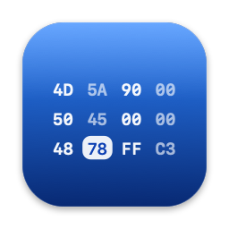
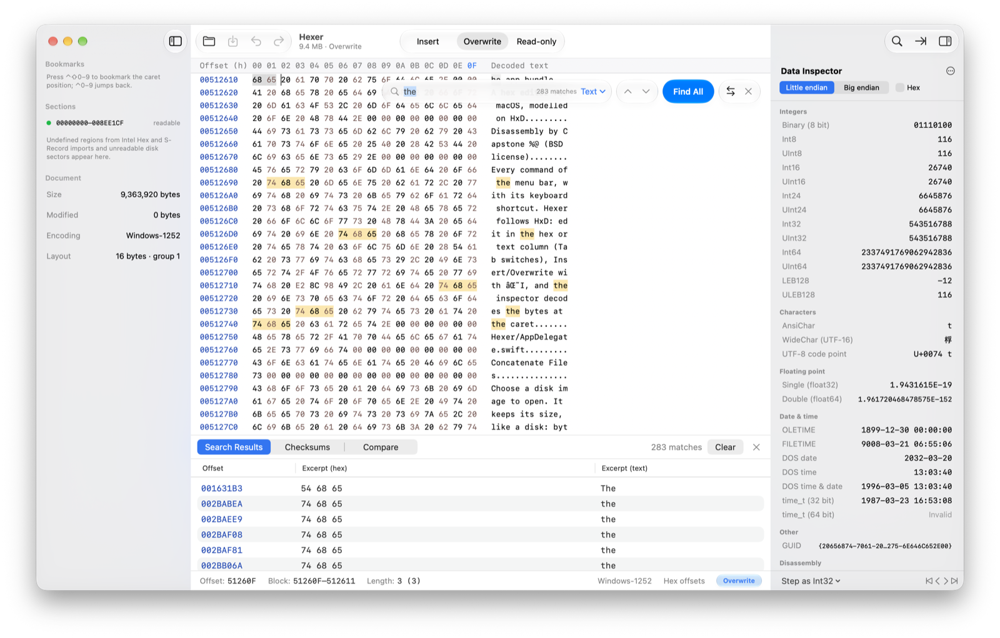
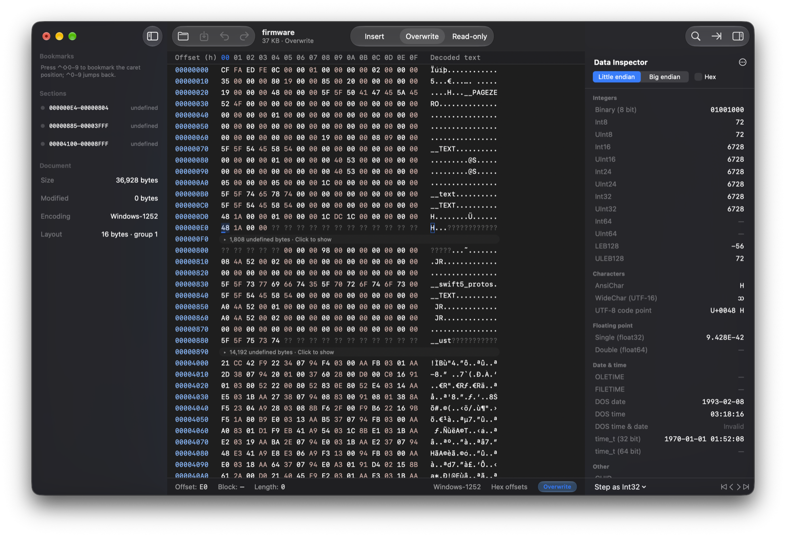
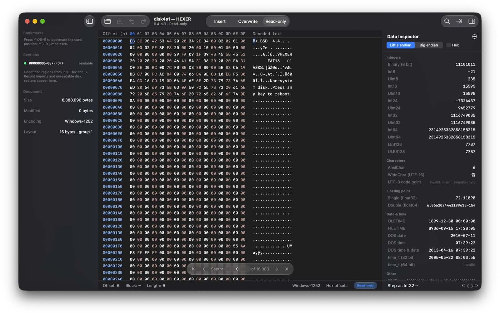
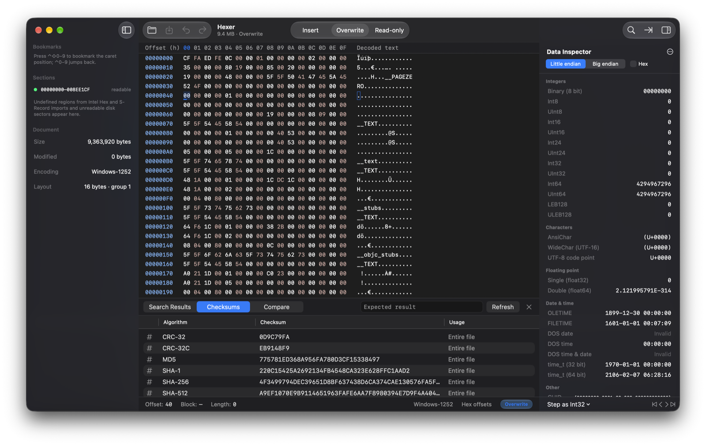
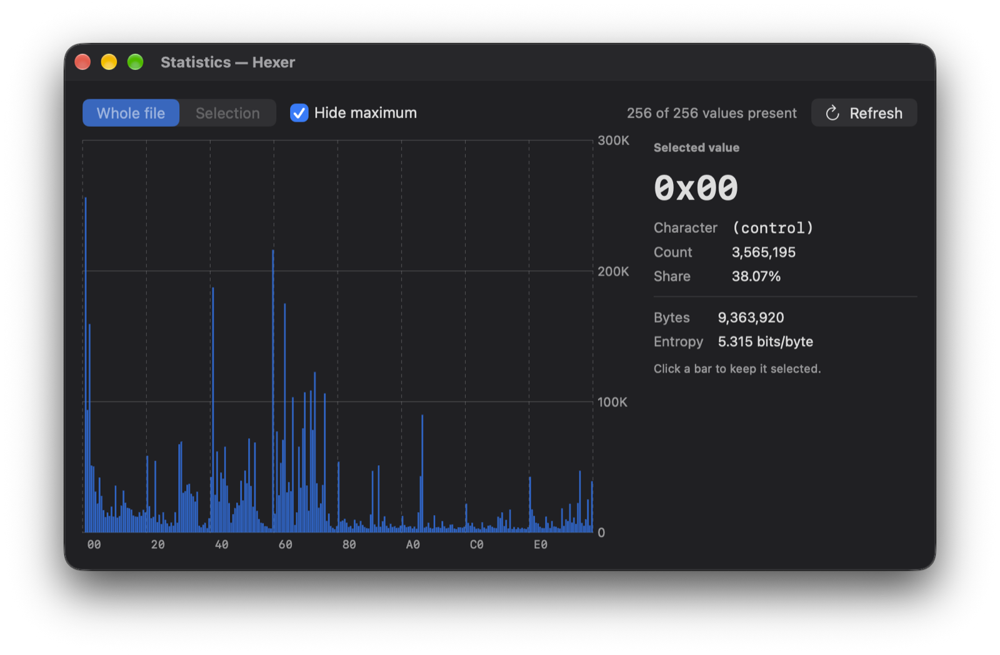
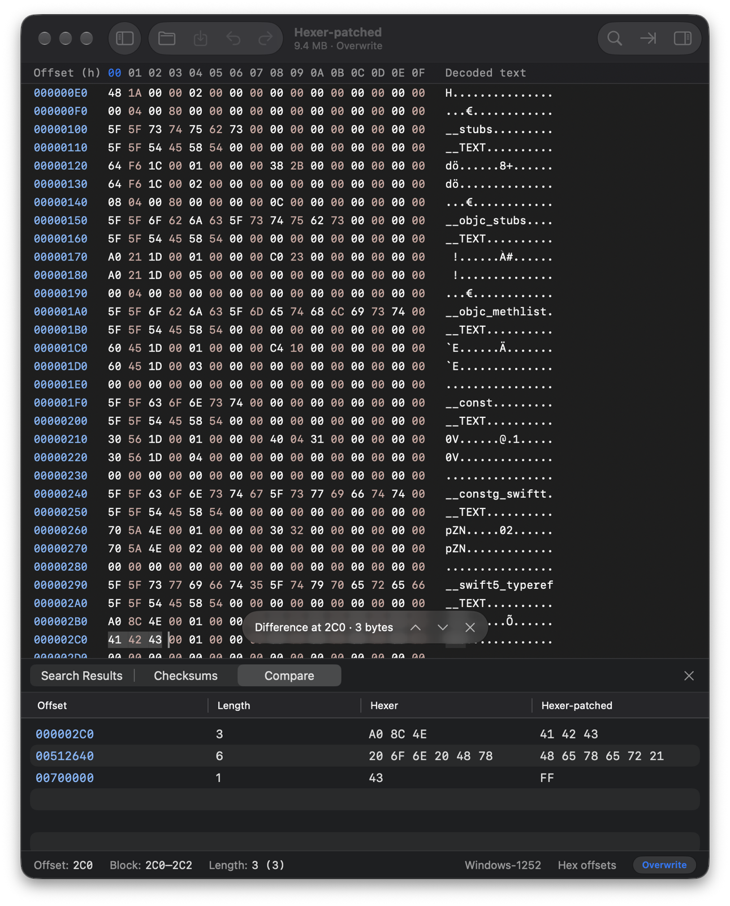
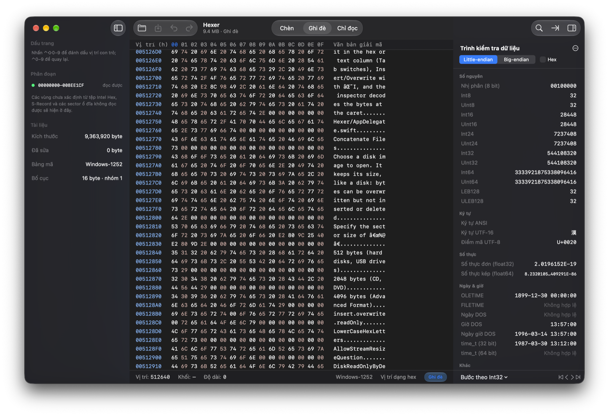

<p align="center">
  
</p>

<h1 align="center">Hexer</h1>

<p align="center">
  A fast, native hex editor for macOS, with the feature set of HxD.
</p>

<p align="center">
  
  
  
  
  
</p>

<p align="center">
  <picture>
    <source media="(prefers-color-scheme: dark)" srcset="docs/images/hero-dark.png">
    
  </picture>
</p>

Hexer opens files, disks and firmware images of any size and lets you inspect, search, compare and edit them byte by byte. It is written in Swift with SwiftUI and AppKit, follows the macOS 27 design language, and builds with the Command Line Tools alone.

## Features

- **Files of any size.** Only the visible rows are read and drawn, so multi-gigabyte files and whole disks open instantly. Undo and redo are unlimited, with insert, overwrite and read-only modes. Saving clones the original on APFS and writes only the changed regions when the size is unchanged.
- **Search and replace.** Text in the editor encoding or UTF-16, hex byte patterns, integers of 8 to 64 bits in either byte order, and single, double, Real48 and extended floats. Find All lists every match; replacements can be confirmed one by one.
- **Data inspector.** Thirty types decoded at the caret, including LEB128, UTF-8 code points, OLE, FILETIME, DOS and Unix dates, GUIDs, and x86-16/32/64 and ARM64 disassembly (Capstone). Values can be edited in place.
- **Analysis.** Checksums and digests (8- to 64-bit sums, CRC-16, CRC-16/CCITT-FALSE, CRC-32, CRC-32C, custom sums and CRC models, MD2, MD4, MD5, SHA-1, SHA-256, SHA-384, SHA-512) with comparison against an expected value; byte statistics with entropy; side-by-side file comparison with a list of every difference.
- **Firmware formats.** Import Intel Hex, Motorola S-Record and ETL Extended files; gaps between records become undefined sections that fold away. Export or copy as Intel Hex, S-Record, C, C#, Java, Pascal, Visual Basic .NET, PureBasic, HTML, RTF or TeX.
- **Disks.** Open physical disks, volumes and disk images with a sector navigator, and clone disks to images or other disks. Disks open read-only by default, and the startup disk can never be written.
- **File tools.** Split, concatenate and securely wipe files.
- **Native on macOS.** Liquid Glass controls, light and dark appearance, VoiceOver support, a menu command and shortcut for every action, and a complete Vietnamese translation.
- **Updates itself.** Hexer looks for a new release once a day and installs it when you agree, after checking its Ed25519 signature and code signature (Hexer ▸ Check for Updates…; turn it off in Settings ▸ General).

## Screenshots

<table>
  <tr>
    <td width="50%"></td>
    <td width="50%"></td>
  </tr>
  <tr>
    <td align="center">Intel Hex import with folded gaps</td>
    <td align="center">Raw volume, read-only, with the sector navigator</td>
  </tr>
  <tr>
    <td width="50%"></td>
    <td width="50%"></td>
  </tr>
  <tr>
    <td align="center">Checksums and digests</td>
    <td align="center">Byte statistics</td>
  </tr>
  <tr>
    <td width="50%"></td>
    <td width="50%"></td>
  </tr>
  <tr>
    <td align="center">File comparison</td>
    <td align="center">Vietnamese user interface</td>
  </tr>
</table>

## Requirements

- macOS 15 Sequoia or later, on Apple silicon or Intel. Designed for macOS 27; Liquid Glass controls appear on macOS 26 and later, standard materials on macOS 15.
- To build: the Command Line Tools for Xcode with Swift 6.2 or later. Xcode itself is not needed.

## Building

```sh
git clone https://github.com/letrucdev/hexer.git
cd hexer
Scripts/bundle.sh        # builds build/Hexer.app
open build/Hexer.app
```

| Command | Purpose |
|---|---|
| `UNIVERSAL=1 Scripts/bundle.sh` | Universal build for arm64 and x86_64 |
| `SIGN_IDENTITY="Developer ID Application: …" Scripts/bundle.sh` | Sign with your identity instead of ad hoc |
| `Scripts/test.sh` | Unit tests (swift-testing), including raw-disk tests on attached disk images |
| `Scripts/crosscheck.sh` | Checks `hexer-cli` against `xxd`, `grep`, `shasum`, `cmp`, `split`, `diskutil`, `dd` and others |
| `git tag vX.Y && git push origin vX.Y` | GitHub Actions tests the tag, builds the disk image and publishes it on the Releases page |
| `Scripts/make_dmg.sh` | Universal disk image for distribution, with installation guides in English and Vietnamese |
| `Scripts/vm_test.sh` | Runs the build on a macOS virtual machine in UTM over SSH (for example macOS 15) and captures screenshots |

## Command-line tool

`hexer-cli` exposes the same engine for scripting and verification:

```sh
swift build -c release --product hexer-cli
CLI=.build/release/hexer-cli

$CLI dump --xxd firmware.bin | head
$CLI find --hex "4D 5A 90" firmware.bin
$CLI checksum --all firmware.bin
$CLI export --format ihex32 firmware.bin -o firmware.hex
$CLI edit firmware.bin -o patched.bin overwrite:0x10:DEADBEEF insert:0:FF
$CLI disks
```

Run `hexer-cli help` for every command: `dump`, `find`, `replace`, `checksum`, `stats`, `diff`, `export`, `import`, `disasm`, `edit`, `split`, `concat`, `disks`, `bench` and `selftest`.

## Project structure

| Module | Contents |
|---|---|
| `HexerCore` | Storage engine (persistent piece tree), search, checksums, statistics, comparison, import and export codecs, data inspector. Pure Swift, no UI. |
| `HexerDisasm` | Swift wrapper around the vendored Capstone 5.0.9 (x86 and AArch64). |
| `HexerPlatform` | Disk enumeration and raw device access through IOKit, DiskArbitration and `authopen`. |
| `Hexer` | The app: AppKit document lifecycle, SwiftUI views and a CoreText hex grid. |
| `HexerCLI` | `hexer-cli`. |

The design notes ([DESIGN.md](DESIGN.md)) and the engineering handbook ([HANDOFF.md](HANDOFF.md)) are written in English.

## Acknowledgements

- The feature set is modelled on [HxD](https://mh-nexus.de/en/hxd/) by Maël Hörz. Hexer is an independent project and is not affiliated with HxD or its author.
- Disassembly is provided by [Capstone](https://www.capstone-engine.org) under the BSD license; see `Resources/Licenses`.
